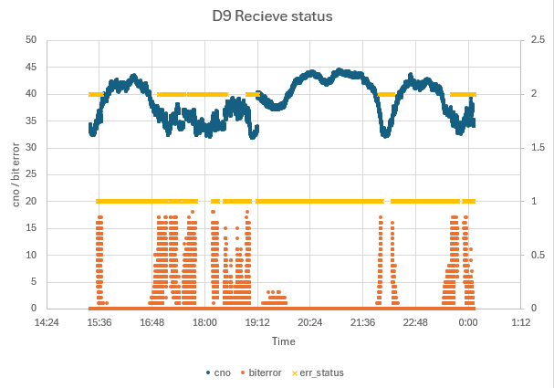

# u-blox D9 のCLASメッセージのダンプ

## これは何？

u-bloxのCLASの受信機であるD9の，受信状況の確認及び，ログをとるためのスクリプト．
メッセージのhexダンプ及び，ビットエラー等のCSVを生成可能．測位データと共にCSVを保存しておくことで，どの時刻でCLASが正しく受信できていた/いなかったを後から確認することができる．アンテナを交換した場合の評価等にも使える．


## PCとの接続

USBケーブルでPCに接続され，シリアルポートとして認識されている状態を前提．

注：D9はF9Pに接続されることが多いが，ここで使うシリアルポートはF9Pのシリアルではなく，D9に直接接続されていること．

## 実行方法

例
```
python3 clas_dump.py --port /dev/ttyACM2 --csv
```

オプション
* --port シリアルポートの指定
* --baudrate ボーレート指定．デフォルトは38400 bps
* --csv CSV形式で出力

表示されるdate，unix_timeはPCの時計で得た時刻に基づく．

## 表示されるペイロード

ubxメッセージのペイロード全体が表示されており，先頭の0-13バイトはu-bloxのヘッダで，14バイト目から QZSS L6 message

ubxメッセージについては下記参照

- https://content.u-blox.com/sites/default/files/u-blox-D9-QZS-1.01_InterfaceDescription_UBX-21031777.pdf


L6 messageの詳細については下記から入手可能

- https://qzss.go.jp/technical/download/ps-is-qzss.html

## CSV形式

列は以下の通り．
```
date,unix_time,ch,svid,cno,biterror,err_status
```

## エラーステータスについて

* 0: unknown
* 1: error-free
* 2: erroneous

このため，エラーステータス=1であれば正常．


## グラフ作成例

CSV出力をファイルに保存し，Excelでグラフ化


